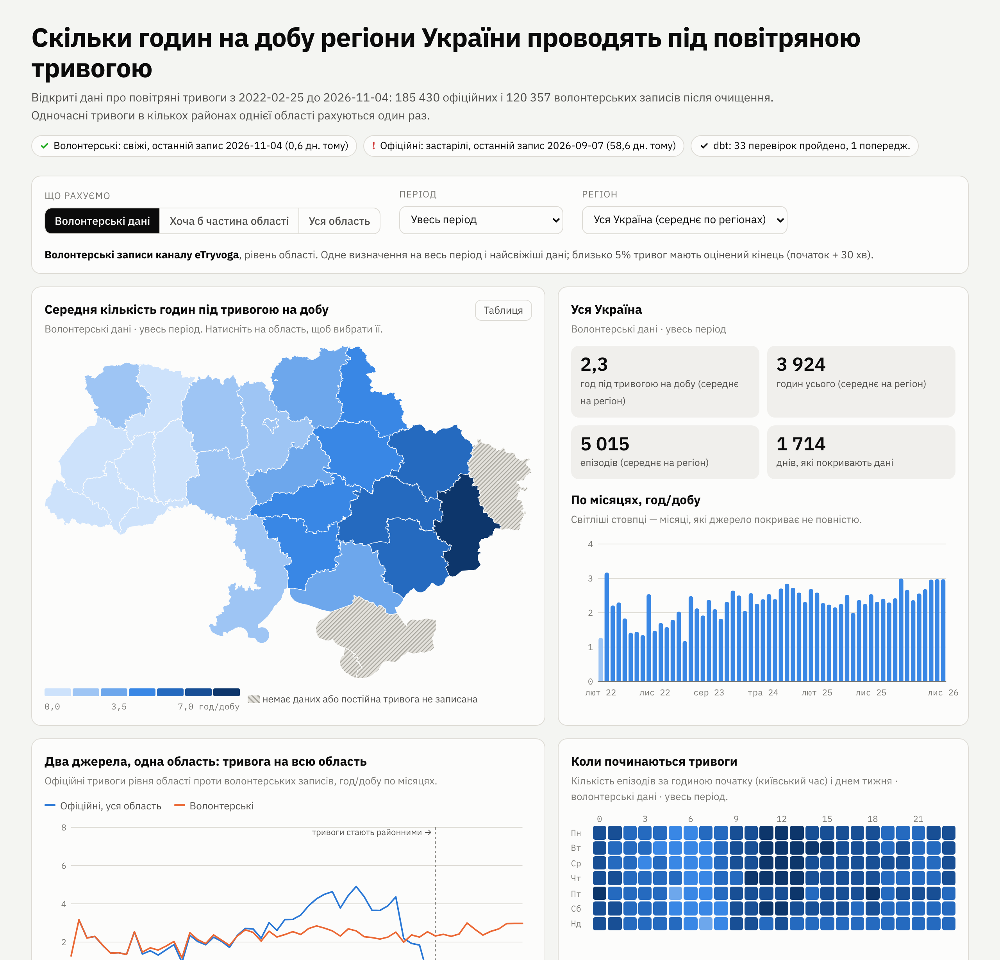
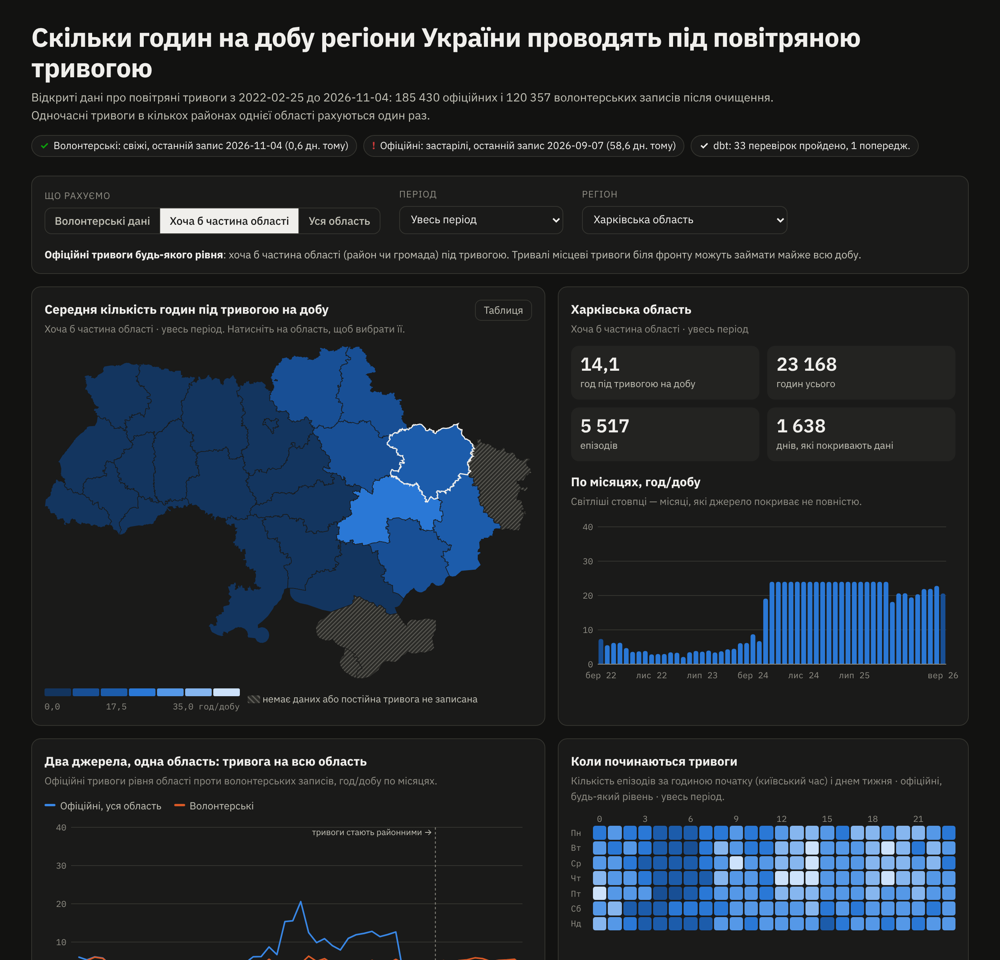

# alerts-pipeline: how many hours a day Ukraine's regions spend under air-raid alert

A small but complete data pipeline built around a public dataset of air-raid alerts in Ukraine:

1. **Ingest:** idempotent downloads with ETag, SHA-256 and schema checks.
2. **Load:** the raw files go into DuckDB.
3. **Transform:** dbt models, with 23 data tests and source-freshness checks.
4. **Export:** the results become a static dashboard with a map that needs no server.



Self-contained mini-project: everything lives in this folder. The dashboard UI is in Ukrainian.

## Run
```bash
make setup           # Python 3.13 venv with pinned duckdb 2.0.0, dbt-core 1.12.6, dbt-duckdb 1.11.1
make run             # ≈ 20 s: download if changed, load, dbt build, freshness, export
make dashboard       # http://localhost:8000
make test            # 15 tests, no network
```
`python -m pipeline run --offline` reuses the last download. `--full-refresh` rebuilds the incremental model.
`--strict` exits with code 2 when a source is stale (for alerting from cron or CI).
`.github-workflow-example.yml` shows a daily GitHub Actions run that publishes the dashboard to Pages.

## Pipeline
```
GitHub raw CSV ─ingest─▶ data/raw/<source>/latest.csv   + ingest_manifest.jsonl (url, ETag, sha256, rows, status)
              ─load──▶ DuckDB raw.*   (text, exactly as published, + file hash and load time)
              ─dbt───▶ staging ▶ intermediate ▶ marts   + data tests, source freshness
              ─export▶ dashboard/data.json (178 KB) + dashboard/index.html (static, SVG)
```
- **Ingest** (`pipeline/ingest.py`):
  - **Conditional download.** It sends a conditional GET; a `304` means there is nothing to do.
  - **Validation.** The download is streamed to a temp file, its size is checked against `Content-Length`, the
    CSV header must match exactly (this guards against schema drift), and ragged rows are rejected.
  - **Atomic replace.** Only a validated file is atomically renamed over the last good copy. Every attempt is
    logged.
  - **Tests.** They use a local HTTP server that imitates GitHub: 200, 304, changed content, renamed columns,
    ragged rows, truncated body, unreachable host, offline mode.
- **Load** (`pipeline/load.py`):
  - The raw layer keeps every value as text; parsing happens in dbt, where failures are counted.
- **dbt** (`dbt/`):

  | layer | models |
  |---|---|
  | seeds | `regions`: dataset name ↔ Ukrainian name ↔ ISO 3166-2 ↔ map shape, generated and checked by `scripts/build_region_seed.py` |
  | staging | typed alerts; exact duplicates kept once; unparseable rows and rows that end before they start dropped (and counted) |
  | intermediate | `int_alert_episodes`: overlapping alerts merged per oblast (gaps-and-islands); `int_episode_days`: episodes split into **Kyiv-local days in absolute time**, so DST days have 23 or 25 hours |
  | marts | `fct_alerts` (incremental, `delete+insert` by start day with a 7-day look-back), `agg_region_daily` (zero-filled, **NULL outside a source's coverage**), `agg_region_monthly` (with coverage days), `agg_start_hour_weekday`, `agg_longest_episodes`, `rpt_data_quality` |

  Tests:
  - unique and not-null keys, accepted values, region relationships;
  - merged episodes never overlap;
  - splitting episodes into days conserves the total minutes;
  - no day holds more than 25 hours of alert;
  - no alerts start in the future;
  - a *warn* lists alerts longer than 7 days.

## Three ways to count, and why it matters
Since December 2025, alerts in Ukraine are declared mostly per raion (district) instead of per oblast (region).
A single "hours under alert" number would therefore change meaning halfway through the data. The pipeline keeps
three clearly defined metrics:

| metric | definition | caveat |
|---|---|---|
| volunteer (dashboard default) | volunteer records (eTryvoga channel), oblast level | one definition for the whole period and the freshest data; about 5% of ends are estimated |
| any part of the oblast (official) | official alerts of any level, merged per oblast | long local alerts in front-line hromadas fill whole days |
| whole oblast (official) | official oblast-level alerts only | collapses after the December 2025 switch to raion-level alerts |

Average hours under alert per day per region (24 regions with records; Luhansk is excluded, see below), as
computed by the pipeline on 2026-11-04:

| year | volunteer | any part (official) | whole oblast (official) |
|---|---|---|---|
| 2022 | 1.94 | 2.20 | 1.86 |
| 2023 | 2.03 | 2.33 | 1.92 |
| 2024 | 2.49 | 4.60 | 3.45 |
| 2025 | 2.35 | 5.87 | 2.96 |
| 2026 | 2.64 | 7.05 | 0.07 |

The divergence is the point of the table. "Any part" climbs because a few hromadas spend months under alert:
the longest official episode, in Kharkiv oblast, lasted from 12 May 2024 to 6 January 2026. "Whole oblast"
nearly vanishes in 2026 because of the change in rules, not because there were fewer alerts. The volunteer
series has a stable definition. The dashboard lets you switch between the three metrics and explains each.

## What the data-quality checks found
Every run of the pipeline reports these findings; the numbers here are from 2026-11-04:
- **Exact duplicates in the official file:** 113,845 of 299,275 rows are identical in every field to another row.
  Every such group has exactly two copies. They are kept once, leaving 185,430 alerts.
- **The official file is stale.** Its newest alert starts on 2026-09-07, 58 days before this run, even though the
  repository was updated today. `dbt source freshness` reports **ERROR STALE** for the official source and
  PASS for the volunteer one. The dashboard shows this at the top.
- **Estimated ends:** 5.1% of volunteer alerts have no reported end, so the end is start + 30 min (`naive`).
- **Long alerts:** 13 official and 2 volunteer alerts last longer than 7 days. They are flagged, not removed.
  The data does not say why. The longest official ones are hromada-level alerts in front-line areas. In the
  volunteer data, a cluster of 4–8-day alerts starting on 17 April 2026 in western oblasts is shown as is; it may
  reflect unreported ends.
- **Coverage:** the dataset does not list the permanent alerts in Luhansk oblast and Crimea (per its README).
  Crimea and Sevastopol are absent, and Luhansk's few early records would mislead. All three are hatched on the
  map and excluded from the national average.

## Tests
```bash
make test     # 15 tests in about 25 s
```
- **Transformation tests** run dbt on hand-made fixtures whose correct answers are known exactly, and check:
  - an alert on the night clocks jump forward (4 h, all on 31 March Kyiv time);
  - a 21:00–01:00 UTC alert (1 h on one Kyiv day, 3 h on the next);
  - four overlapping raion and hromada alerts, two with identical times (one 2-hour episode);
  - duplicates and broken rows;
  - NULL rather than 0 outside coverage;
  - month totals;
  - start hours in Kyiv time;
  - **an incremental re-run is identical to a full refresh**.
- **Timezone tests** check that DuckDB's ICU is statically linked (`Europe/Kyiv` works offline) and get the DST
  switch right.
- **Export tests** cover map simplification.

A bug caught on the real data and fixed: the gaps-and-islands model used two window functions ordered by
`(started_at, finished_at)`. Many alerts share both values (several hromadas alerted in the same second), and
DuckDB's parallel execution could order those ties differently in the two windows. Episode numbering then
became non-deterministic: the overlap test passed on one run and failed on the next. The order is now total
(`alert_id` breaks ties), and the build passed four times in a row afterwards.

The final review found two more problems, reproduced and fixed:
- **One bad value disabled freshness monitoring.** A single unparseable `started_at` made the freshness query for
  that source crash, and the source silently disappeared from the freshness report. The check now uses
  `try_cast`, and the pipeline reports any missing source as a failure instead of omitting it; a fixture test
  covers this.
- **Stale results could be misreported.** A dbt run that failed early could have reported the previous run's
  results. The artifacts are now deleted before each run.

Also hardened in the same review:
- metadata files are written atomically;
- unexpected exceptions are logged to the run log with exit code 1;
- the dashboard escapes text it puts into HTML.

## Measured (4-vCPU cloud VM, Python 3.13, DuckDB 2.0.0)
- **Full run:** about 18–20 s.
  - ingest 1.7 s when nothing changed, about 4 s for the first download of 41 MB;
  - load 0.9 s for 419,632 rows;
  - dbt build 9–12 s (34 nodes);
  - freshness 3.4 s;
  - export 0.2 s.
- **Episodes:** 265,959 after merging (official, any level: 80,288; official, oblast-wide: 65,314;
  volunteer: 120,357).
- **Dashboard data:** `data.json` is 178 KB. The region outlines are simplified from 761 KB of GeoJSON to 80 KB of
  SVG paths (Douglas–Peucker).

## Attribution and licences
- **Alert data:** [Vadimkin/ukrainian-air-raid-sirens-dataset](https://github.com/Vadimkin/ukrainian-air-raid-sirens-dataset),
  MIT licence, © 2022 Vadym Klymenko. The volunteer data comes from the eTryvoga channel.
- **Region boundaries:** [geoBoundaries](https://www.geoboundaries.org) UKR ADM1 (sources: OpenStreetMap,
  Wambacher), Open Database License 1.0. The simplified outlines in `dashboard/data.json` are a derived database
  under the same licence, © OpenStreetMap contributors.
- **Language:** the dashboard describes time under alert. It makes no claims about attacks or damage, which this
  data does not contain.


