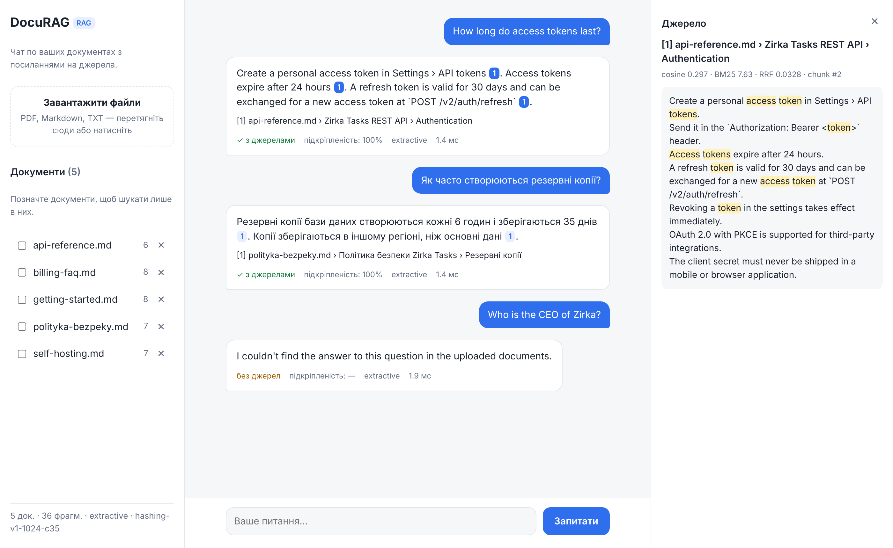

# 📚 DocuRAG — chat with your documents, with citations you can check

Upload PDF / Markdown / TXT files and ask questions in English or Ukrainian. Every sentence of the answer carries a
clickable `[n]` citation that opens the exact chunk it came from. When the documents don't contain the answer, the
assistant says so instead of guessing.



Self-contained mini-project: everything lives in this folder. Runs **fully offline by default** (no API keys, no model
downloads); plug in a local LLM (Ollama) or Claude for fluent, synthesised answers.

## Features
- **Ingestion**: PDF (page-aware), Markdown (heading-path-aware, tables → sentences), TXT (UTF-8 / CP1251);
  idempotent by SHA-256, re-upload replaces the old version atomically
- **Sentence-aware chunking** with overlap; chunks never cross a heading / page boundary, so citations are precise
- **Hybrid retrieval**: dense cosine + BM25, fused with Reciprocal Rank Fusion; optional per-document filter
- **Relevance gate + abstention**: weak matches never reach the generator; out-of-scope questions are declined
- **Generators**: `extractive` (offline, cannot hallucinate), `ollama` (local LLM), `anthropic` (Claude API) —
  automatic fallback to extractive if the LLM fails
- **Citation validation**: markers pointing at non-existent sources are removed and reported
- **Groundedness score** per answer (share of sentences supported by the sources they cite)
- **Evaluation harness**: hit@k, MRR, keyword recall, citation precision, abstention; dense / BM25 / hybrid ablation;
  a pytest quality gate that fails on regressions
- FastAPI REST API, vanilla-JS chat UI (light/dark), CLI, Docker, optional API key for write endpoints

## Quick start
```bash
python -m venv .venv && . .venv/bin/activate
pip install -r requirements-dev.txt
uvicorn app.main:app --reload            # http://localhost:8000  (API docs: /docs)
```
On first start the bundled demo docs (`sample_docs/`, about the fictional product *Zirka Tasks*) are indexed.
Try: *"How long do access tokens last?"*, *"Як часто створюються резервні копії?"*, *"What is the capital of France?"*.

### Docker
```bash
docker compose up --build                                  # http://localhost:8000
RAG_PROVIDER=anthropic ANTHROPIC_API_KEY=... docker compose up --build
docker compose --profile ollama up                         # + local Ollama (pull a model, set RAG_PROVIDER=ollama)
```

### CLI
```bash
python -m app.cli ingest ~/docs/ handbook.pdf
python -m app.cli ask "How do I verify webhook requests?"
python -m app.cli list
python -m app.cli --provider anthropic ask "Summarise the refund policy"
```

## Using an LLM
| `RAG_PROVIDER` | What happens | Needs |
|---|---|---|
| `extractive` (default) | Picks the source sentences that best cover the question | nothing |
| `ollama` | Local LLM writes the answer; nothing leaves the machine | Ollama + `OLLAMA_MODEL` |
| `anthropic` | Claude writes the answer (`ANTHROPIC_MODEL`, default `claude-opus-5-5`) | `pip install -r requirements-optional.txt`, `ANTHROPIC_API_KEY` |

The LLM gets numbered `<source>` blocks and strict rules: cite every factual sentence, use only the sources, answer
with a fixed "not found" sentence otherwise, and treat source text as untrusted (prompt-injection hygiene). If the
LLM call fails, the extractive generator answers and the response carries a warning.

For real neural embeddings: `RAG_EMBEDDER=sentence-transformers` (multilingual MiniLM by default). Switching
embedders re-embeds the stored chunks automatically on the next start.

## API
| Method | Path | |
|---|---|---|
| `POST` | `/api/ask` | `{"question": "...", "k": 5, "doc_ids": [1, 2]}` → answer, citations, sources, scores, timings |
| `POST` | `/api/documents` | multipart `files` (one or many) |
| `GET` | `/api/documents` | list |
| `DELETE` | `/api/documents/{id}` | delete a document and its chunks |
| `GET` | `/api/documents/{id}/chunks`, `/api/chunks/{id}` | inspect what was indexed |
| `GET` | `/api/health` | embedder, provider, counts |

Set `RAG_API_KEY` to require an `X-API-Key` header on uploads and deletes. All settings: [`.env.example`](.env.example).

## Evaluation
```bash
python -m app.evaluate                      # sample docs + eval/questions.json
python -m app.evaluate --provider anthropic --json report.json
```
Results on the bundled set (27 questions: 23 answerable incl. 4 in Ukrainian, 4 unanswerable), default offline
configuration (hashing embeddings + extractive answers), k = 5:

| retrieval | hit@1 | hit@5 | MRR |
|---|---|---|---|
| dense | 0.87 | 1.00 | 0.92 |
| BM25 | 0.91 | 0.96 | 0.93 |
| hybrid | 0.87 | 1.00 | 0.92 |

| answers | value |
|---|---|
| answered with citations | 1.00 |
| keyword recall | 0.96 |
| citation precision | 0.98 |
| groundedness (heuristic) | 1.00 |
| correct abstention | 1.00 |

Honest notes: the set is small and was written together with the demo docs, so treat these as a regression baseline
rather than a benchmark. Groundedness is 1.00 by construction for the extractive generator (it copies sentences);
it becomes informative with an LLM. One known miss: *"How do I back up a self-hosted server?"* — "back up" vs
"backup" defeats the lexical extractor, though retrieval still finds the right section. LLM-provider scores are not
included here because they were not measured in this environment.

`tests/test_evaluate.py` runs the same evaluation as a quality gate in the test suite.

## Tests
```bash
pytest          # 34 tests: loaders (incl. a generated PDF), chunking, retrieval, citations, fallbacks, API, quality gate
```

## Design decisions & limitations
- **SQLite + NumPy instead of a vector DB.** Exact search over a few thousand chunks takes milliseconds and keeps the
  project dependency-light. `Store` is a small interface; swapping in pgvector / Chroma is a contained change.
- **Hashing embeddings by default** keep the project runnable offline and in CI. They capture lexical similarity
  (with character n-grams for inflection), not deep semantics; that's what the sentence-transformers option is for.
- **Groundedness is lexical**, a cheap proxy: it catches fabricated or mis-cited sentences, but can under-score a
  correct paraphrase. An LLM-as-judge would be the next step.
- Scanned PDFs (images without a text layer) are rejected with a message; OCR is out of scope.
- No conversation memory: each question is answered independently.

More detail: [docs/architecture.md](docs/architecture.md).
