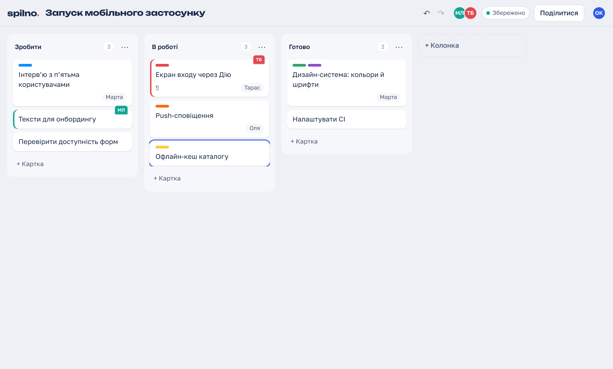
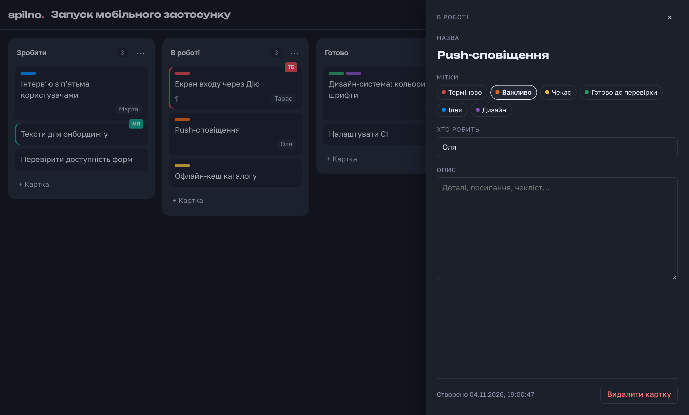
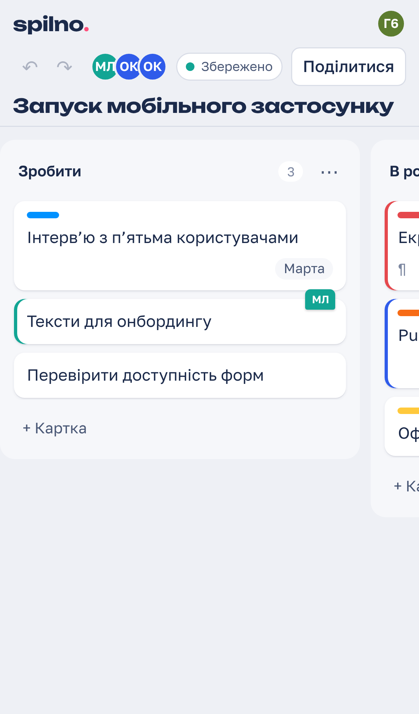

# Spilno — a kanban board the whole team edits at once

*Spilno* ("together" in Ukrainian) is a real-time collaborative kanban board. Several people move cards,
rename columns and type in the same card description simultaneously. Everyone sees who is on the board and
which card each person has open. It keeps working **offline**: edits made without a connection merge
automatically when the connection returns, with no conflict dialogs.



Self-contained mini-project: everything lives in this folder. UI language: Ukrainian.

| | |
|---|---|
|  |  |

## What it does
- **Live collaboration** on columns, cards, labels and assignees, plus the board title.
- **Shared text**: two people typing in the same card description at the same time both keep their text,
  character by character, and each person's caret stays where they are typing.
- **Presence**: avatars of everyone on the board. A coloured *ink tab* sticks out of a card that someone else
  has open or is dragging.
- **Offline-first**: the board is stored in the browser (IndexedDB). You can edit offline and even close the
  tab. On the next visit the edits sync. A status pill shows *Збережено* (saved), *Синхронізую…* (syncing) or
  *Офлайн* (offline).
- **Undo/redo of your own changes only**: Ctrl+Z never reverts what a colleague just did.
- **Drag and drop by mouse, touch and keyboard**:
  - Space picks a card up;
  - arrow keys move it, including across columns;
  - Space drops it;
  - Enter opens it.

  Screen-reader announcements are in Ukrainian.
- Light and dark themes, phone layout, visible focus, `prefers-reduced-motion` support.
- No accounts: a board's link (a 22-character random id, about 130 bits) is the permission to edit, the same
  model Excalidraw uses.

## Run
```bash
npm install
npm run build && npm start          # http://localhost:8787
```
To develop with hot reload, run `npm run dev`: the Vite dev server is on :5173 and proxies `/ws` to the sync
server on :8787.

```bash
docker compose up --build           # http://localhost:8787, boards stored in a Docker volume
```

## How it works
```
 browser A ── React UI ── Board model ── Y.Doc ──┬── y-indexeddb (local copy, offline)
                                                 └── y-websocket ──┐
 browser B … (same)                                                │  WebSocket, y-websocket protocol
                                                                   ▼
                          Node server: one room per board ── Y.Doc + awareness (presence)
                                                         └── SQLite (node:sqlite): update log + snapshots
```
- **CRDT (Yjs).** Every client holds a full copy of the board. Edits merge deterministically in any order, so
  there is no server-side conflict logic and offline editing comes for free.
- **Card positions are one value: `pos = {column, key}`.** `key` is a *fractional index*, a string that sorts
  between its neighbours. A move writes only that value, so two people moving the same card at once end up
  with it in exactly one place (last writer wins). The common alternative, deleting and re-inserting into a
  shared list, leaves the card in both places after such a race. Keys get a random suffix, so two people
  inserting into the same gap rarely collide. If they do, the card id breaks the tie identically everywhere.
- **Deleted column versus concurrent move.** If one person deletes a column while another moves a card into it,
  the card is not lost: it appears in a *"Без колонки"* (no column) section that people can drag from.
- **The server is my own implementation of the y-websocket protocol**, built on the official `y-protocols`
  package. The stock browser client works with it unchanged, and an integration test checks this.
  - **Storage:** every update is appended to SQLite. The log is compacted into one snapshot every 500 updates
    and when a board goes idle.
  - **Limits:** maximum message size, a per-connection token bucket, maximum connections per board, and a
    maximum document size (beyond it the board becomes read-only).
  - **Operations:** a heartbeat drops dead connections; `/healthz` and Prometheus `/metrics` are available;
    shutdown is graceful.
- **Defensive reading.** Anyone with the link can write anything into the document, so `Board.view()` skips or
  coerces malformed data instead of crashing the UI. A unit test injects such data.

More detail: [docs/architecture.md](docs/architecture.md).

## Tests
```bash
npm test             # 12 server integration tests + 24 web unit/property tests
npm run test:e2e     # 7 Playwright tests in real Chromium (builds first)
npm run typecheck
```
- **Convergence (property-based, fast-check):**
  - 2–5 replicas apply random operations: add, move and delete cards; add, move, rename and delete columns;
    labels; text edits.
  - Updates travel over a simulated network that delivers them partially, reordered and duplicated.
  - After the network heals, every replica must show the same board, every card must appear exactly once,
    and the order inside each column must match the keys.
  - 400 random sessions plus one 3,000-step session.

  A probe run confirmed the generator really produces the hard cases: orphaned cards appeared in 246 of 300
  sessions.
- **Text binding:**
  - 2,000 random cases checking that a diff reproduces the new text;
  - 2,000 random cases checking that caret transformation matches Yjs relative positions exactly.
- **Server, with the real y-websocket client:**
  - sync between clients;
  - board isolation;
  - late joiners;
  - data survives a server restart;
  - compaction preserves the document;
  - presence is removed on disconnect;
  - idle rooms are unloaded;
  - bad board ids are rejected;
  - oversized, malformed and flooding connections are closed;
  - per-room connection cap;
  - document size limit;
  - health and metrics endpoints.
- **E2E, with two or three separate browser profiles:**
  - live edits and presence;
  - **both people edit offline**, one renaming a card while the other moves it, and everything merges on
    reconnect;
  - offline edits survive closing the tab;
  - undo reverts only your own changes;
  - mouse drag, keyboard moves within a column and across columns, and Enter to open;
  - simultaneous typing in one description;
  - bad links.

  The suite passed 21 out of 21 runs (`--repeat-each=3`).

The tests caught real bugs during development. These were fixed and stay covered by tests:
- **Lost and scrambled text.** A colleague's text could be erased, or your own letters scrambled, when someone
  typed while a remote edit was arriving. Two things caused it:
  - React state lagged behind the shared text; the description field is now uncontrolled and updated
    synchronously.
  - A focus effect re-ran on every board update and stole focus.
- **No keyboard moves across columns.** dnd-kit's stock keyboard handling only reorders within a column; a
  custom coordinate getter now moves cards between columns.
- **Status stuck on "connecting…"** after the network returned while the socket had survived.
- **Order keys grew quadratically when appending:** 248 characters after 1,000 appends, now 31.

## Measurements
Everything ran in one process on a 4-vCPU cloud VM (Intel Xeon 2.8 GHz, Node 22.23): the server and real
y-websocket clients over loopback. There is no real network latency in these numbers, so treat them as the
software's own overhead.

The table shows the range over two runs:

| | p50 | p95 |
|---|---|---|
| edit → the other person's board (500 edits) | 0.55–0.57 ms | 1.0–1.1 ms |
| edit → all 49 other people in one room (100 edits) | 2.0–2.3 ms | 5.1–7.3 ms |

- **Storage:** a session of 2,000 edits (adds, moves, deletes, description typing) wrote a 218–226 KB update log.
  After compaction the snapshot was 101–104 KB, about 2.2× smaller. Sizes vary slightly because ids and order
  keys are random.
- **Web bundle:** 123 KB of JavaScript (gzip).
- **Docker image:** 260 MB. Of that, the Node base is about 150 MB, the server's dependencies are 12 MB and the
  web build is 2.4 MB.

```bash
npm run bench        # reproduces the table above
```

## Limitations
- **No accounts or roles.** The link is the key. `ALLOWED_ORIGINS` restricts which sites may open WebSockets.
  Real permissions would need an auth layer in front of the WebSocket upgrade.
- **One server process holds the live boards.** To scale out, route by board id (sticky) or put a shared
  pub/sub between instances, as `y-redis` does.
- **The server cannot validate what clients write into a CRDT.** It enforces size and rate limits; the client
  model reads defensively.
- **Moving the same card concurrently is resolved by "last writer wins".** One person's move wins.
- **Removing a board from "recent boards" does not delete it.** It only removes it from the list. The copy in
  the browser and on the server remain.
- Descriptions are plain text, not rich text.
- There is no version history or activity log yet.
